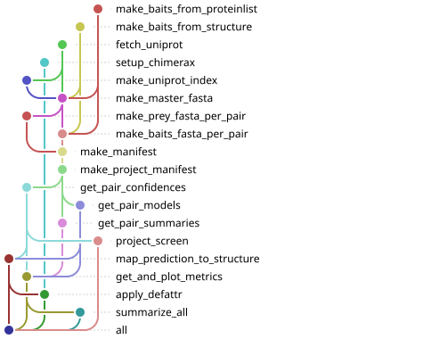

# AF3 screening workflow

<p align="center">
    
</p>

A snakemake workflow to screen protein-protein interactions between a list of "preys" and all proteins in one or more lists or "baits", using [Alphafast](###Alphafast) (faster implementation of Alphafold 3). The baits may come from a .cif structure, in which case the per-residue prey contact probability will be projected on the structure.

Uses a modified [ipSAE](###ipSAE) calculation script to allow specifying an output dir and [forked Alphafast](https://github.com/JoseFcoMH/alphafast) to run alphafast from an uDocker container.

Less barren usage intructions [here](config/README.md).

# Dependencies
  - Conda
  - Python >= 3.10
  - Snakemake >= 9

# References
### This repo: [Publication](https://www.cell.com/molecular-cell/fulltext/S1097-2765(26)00288-1)
### Alphafast: [Repo](https://github.com/RomeroLab/alphafast)   [Paper](https://www.biorxiv.org/content/10.64898/2026.02.17.706409v1)
### ipSAE: [Repo](https://github.com/DunbrackLab/IPSAE)   [Paper](https://www.biorxiv.org/content/10.1101/2025.02.10.637595v1)
### [ChimeraX](https://www.cgl.ucsf.edu/chimerax/)

# TODO

  - Improve docs 
    - Add example outputs.
    - Better describe usage.

```
